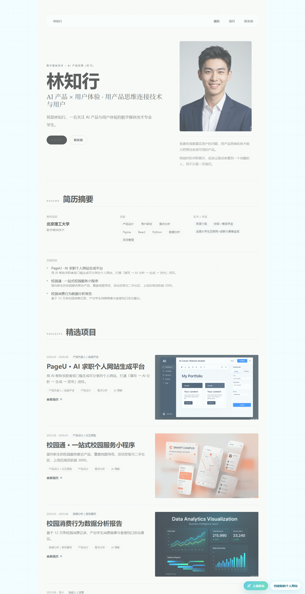
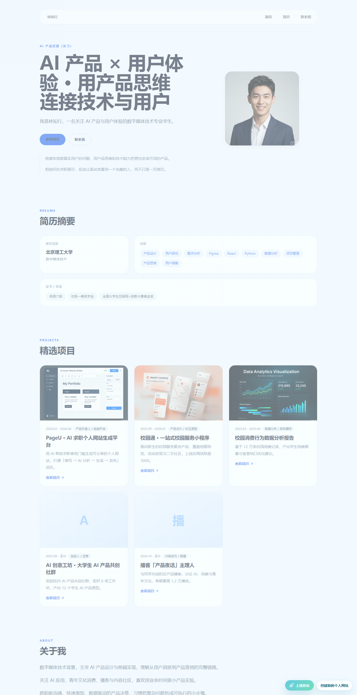
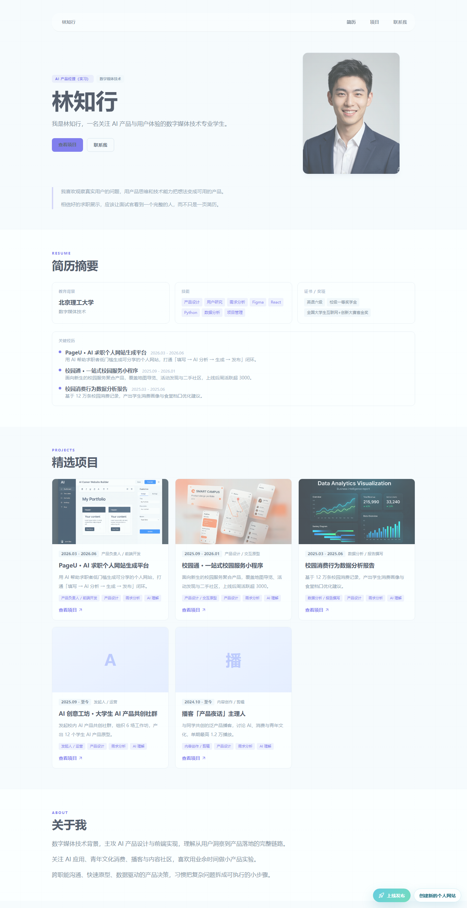
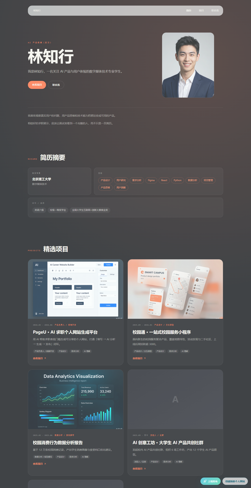

# PageU — AI 个人求职网站生成器

> 填一段经历，AI 读懂它，生成一个可以直接发出去的求职个人网站。

**[🌐 在线体验](https://pageu-ai-career.netlify.app)** · 无需注册，全程免费

<br />

<table>
  <tr>
    <td width="50%"><p align="center"><b>Resume</b> · 极简简历</p></td>
    <td width="50%"><p align="center"><b>Developer</b> · 清爽开发者</p></td>
  </tr>
  <tr>
    <td width="50%"><p align="center"><b>Case</b> · 案例作品集</p></td>
    <td width="50%"><p align="center"><b>Cinematic</b> · 电影感品牌</p></td>
  </tr>
</table>

---

## 一、要解决的问题

求职者都知道「有个个人网站会加分」，但真要做，门槛堆在三个地方：

| 门槛 | 现实情况 |
|---|---|
| 会写代码 | 前端三件套 + 部署 + 域名，非技术岗直接劝退 |
| 会设计 | 免费模板千篇一律，改配色改排版又是一轮学习成本 |
| 会讲故事 | 经历写不出来、亮点提炼不出来，最后变成简历复读 |

PageU 把这三件事压成一次填空：**你只负责讲事实，AI 负责提炼亮点、排版、生成网页。**

---

## 二、产品流程

```
输入经历  →  AI 分析  →  编辑预览  →  一键发布
   ↓            ↓           ↓            ↓
 结构化表单   亮点/标签    4 套模板      在线链接
 头像/封面    可追问调整    实时双向      二维码
```

### 1. 输入
结构化表单收集教育背景、项目/比赛经历、技能证书。支持上传头像与项目封面，所见即所得。草稿自动存本地，刷新不丢。

### 2. AI 分析
「小U」读取全部输入，输出结构化的分析结果：**核心亮点、能力标签、可优化项**。
不满意可以追问重来——直接说「项目经历讲得太散」「突出我的数据能力」，AI 会据此重新分析。

### 3. 编辑
四套视觉风格完全不同的模板，切换即换皮。左侧改字段、右侧实时预览，桌面/移动双视图切换。

### 4. 发布
一键发布到线上，得到 `pageu-ai-career.netlify.app/site/{id}` 这样的可访问链接，同时生成二维码——可以直接贴进简历 PDF。

---

## 三、技术实现

**技术栈**

| 层 | 选型 |
|---|---|
| 框架 | React 19 + Vite 6 |
| 路由 | React Router 7 |
| 样式 | Tailwind CSS 4（`@tailwindcss/vite`） |
| 动画 | Framer Motion 12 |
| 图标 | lucide-react |
| 二维码 | qrcode |
| AI | 阿里云 DashScope · qwen-plus（OpenAI 兼容接口） |
| 后端 | Netlify Functions + Netlify Blobs |
| 测试 | Vitest 3 + Testing Library · **57 项测试全通过** |

**几个设计决策**

- **模板与数据解耦**：`src/renderers/` 下每套模板是独立的纯展示组件，只吃统一的 `siteDraft` 结构。加第 5 套模板不用动任何业务逻辑，只需在 `src/data/templates.js` 注册。
- **AI 失败不阻塞用户**：`src/services/ai/` 层做了完整降级——无 Key、请求失败、JSON 解析失败、字段缺失，全部回落到本地 Mock 分析，页面照常走完。作品集不能因为 API 挂了就变白屏。
- **端到端有测试兜底**：57 项测试覆盖完整创建流、编辑器实时预览、发布流程、AI 降级路径，改代码前先跑一遍能挡住大部分回归。

---

## 四、本地运行

```bash
# 1. 安装依赖
npm install

# 2. 配置 AI（可选，不配也能跑，会走 Mock 分析）
cp .env.example .env.local
# 填入 VITE_DASHSCOPE_API_KEY

# 3. 启动
npm run dev      # 开发服务器
npm test         # 跑测试
npm run build    # 生产构建
```

> 不配置 API Key 时，AI 分析自动使用内置 Mock 结果，全部页面流程仍可完整体验。

---

## 五、已知限制

诚实记录，不算完美：

- **AI Key 目前在浏览器端调用**：使用 `VITE_` 前缀环境变量，构建后 Key 会进入前端产物。适合个人 Demo，**不适合公开生产环境**。正式做法是把调用收进 Netlify Function 做服务端代理。
- **发布站点公开可读**：站点数据存在 Netlify Blobs，知道链接即可访问，没有鉴权。
- **无账号体系**：草稿存本地 localStorage，换设备或清缓存即丢失。
- **模板固定为 4 套**：AI 只选风格，还不支持从零生成全新版式。

---

## 六、作者

**曹桎康** · 市场营销硕士在读，本科软件工程
求职方向：AI 产品经理 / AI 行业

- GitHub：[@czk775](https://github.com/czk775)
- 项目仓库：[czk775/pageu](https://github.com/czk775/pageu)

---

## License

[MIT](LICENSE)
